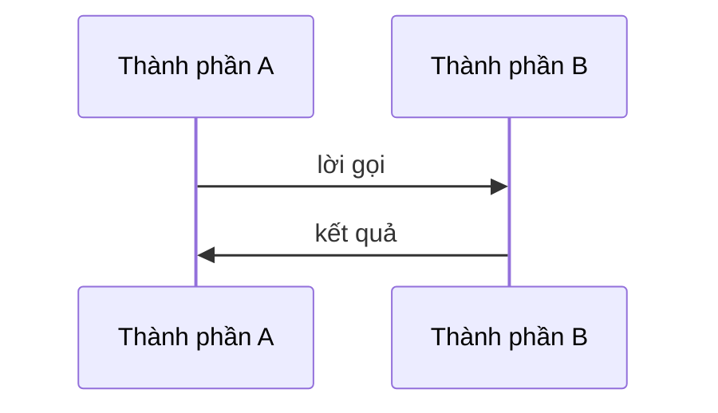

<!--
============================================================
  PULL REQUEST TEMPLATE - Đồ án tốt nghiệp
  Mục nào không áp dụng thì xóa cả tiêu đề mục.
  Trước khi chuyển Ready for review: đọc lại mô tả, đảm bảo khớp với diff hiện tại.
  Hướng dẫn và PR tham khảo: CONTRIBUTING.md, Bước 6.
============================================================
-->

## Tóm tắt

<!--
Người chưa đọc ticket và chưa mở diff, đọc xong mục này phải kể lại được PR làm gì.
Thuật ngữ đã có thì dùng đúng như trong CONTEXT.md. Khái niệm mới do PR đưa vào thì định nghĩa một câu.
-->

- **Trước:** <!-- Hệ thống đang làm gì, hoặc còn thiếu gì. -->
- **Sau:** <!-- Hành vi quan sát được khi PR được merge. -->
- **Vì sao:** <!-- Vấn đề hoặc yêu cầu của ticket/ADR, 1 đến 2 câu. -->
- **Chưa làm:** <!-- Phần người đọc dễ tưởng PR đã làm nhưng chưa, kèm link ticket theo dõi. Ghi "Không" nếu không có. -->
- **Ticket:** <!-- Link đầy đủ tới ticket Jira, ví dụ https://datn-fit-hcmus.atlassian.net/browse/CDA-28. Nếu PR nằm trong một chuỗi ticket: dựa trên ticket nào, mở đường cho ticket nào. -->

## Ví dụ

<!--
Một ví dụ cụ thể cho thấy hành vi mới. Có thể là:
- output TUI/CLI: ảnh, asciinema hoặc GIF;
- Tool Result, chuỗi Session Event;
- input và output của một hàm public.
Nếu PR sửa hành vi có sẵn thì để cả trước và sau.
-->

## Thay đổi

<!--
Bản đồ diff theo file hoặc module, không kể lại code từng dòng.
- Ghi rõ phần cốt lõi cần soi kỹ, phần cơ học (đổi tên, test kit, docs) và thứ tự nên đọc.
- Nếu đổi type được export hoặc hợp đồng giữa các package: ghi cũ → mới và package nào bị ảnh hưởng.
-->

## Flow

<!--
Bắt buộc khi PR thêm hoặc đổi luồng chạy qua từ 2 thành phần trở lên, thêm hoặc đổi trạng thái của
session, hoặc có vấn đề về thứ tự xử lý, chạy đồng thời. Các trường hợp khác thì xóa mục này.

- Chỉ vẽ phần PR thêm hoặc đổi. Nếu sửa một luồng đã có thì vẽ trước và sau, hoặc tô đậm node mới
  bằng `classDef`.
- Mỗi sơ đồ có một câu dẫn: sơ đồ cho thấy gì, reviewer nên nhìn vào đâu.
- Chọn loại sơ đồ:
  - `sequenceDiagram`: các thành phần gọi nhau theo thời gian (Agent Core, ModelPort, provider, Host, TUI).
  - `flowchart`: rẽ nhánh bên trong một thành phần.
  - `stateDiagram-v2`: thêm hoặc đổi trạng thái của session.
- Khoảng 15 node trở xuống, lớn hơn thì tách thành nhiều sơ đồ. Ánh xạ lỗi sang mã lỗi thì viết
  thành bảng, không vẽ.
- Dùng thuật ngữ trong CONTEXT.md. Mở tab Preview để chắc sơ đồ hiển thị được.

Khung mẫu, chép ra ngoài comment rồi sửa (mũi tên trả về nét đứt của Mermaid có chuỗi đóng comment
HTML, nên khung mẫu dùng nét liền):

-->

## Quyết định thiết kế

<!--
Những chỗ ticket và ADR không quy định sẵn: đã chọn gì, vì sao, phương án nào bị loại, nhược điểm
còn lại. Gợi ý dạng bảng:

| Tình huống | Quyết định | Lý do |
|---|---|---|
-->

## Kiểm thử

<!--
Không liệt kê lại test, typecheck, lint, build mà CI đã chạy. Ghi:
- Lệnh test riêng cho thay đổi này và kết quả.
- Kịch bản mà test mới bao phủ: luồng chính và các edge case quan trọng.
- Phần chưa kiểm thử được và lý do, ví dụ Windows chưa chạy end-to-end.
- Cách reviewer tự tái hiện bằng tay, nếu có.
Xóa mục này nếu PR không đổi code.
-->

## Rủi ro và ngoài phạm vi

<!--
- Rủi ro đã biết, phần cần reviewer chú ý đặc biệt.
- Việc cố ý để lại cho sau: mỗi việc kèm link ticket Jira theo dõi.
-->

## Checklist

- [ ] Đã tự review toàn bộ diff, giải thích được mọi dòng, không có file nhạy cảm hay code debug
- [ ] PR chỉ phục vụ một mục đích
- [ ] Đã cập nhật docs, ADR, CONTEXT.md bị ảnh hưởng, hoặc không cần cập nhật
- [ ] Mô tả và Flow khớp với code hiện tại, sẽ cập nhật nếu code đổi trong lúc review
