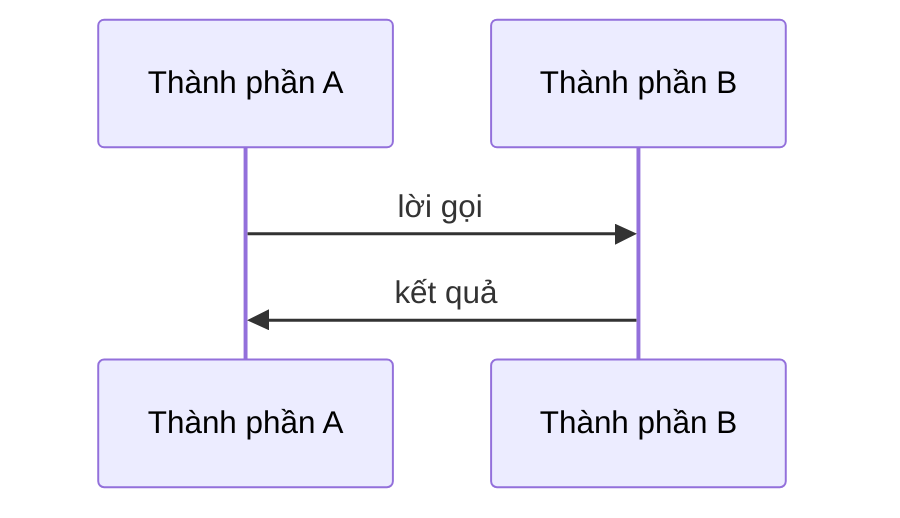

<!--
============================================================
  PULL REQUEST TEMPLATE (Đồ án tốt nghiệp)
  Tóm tắt luôn phải có. Ví dụ luôn giữ tiêu đề mục, PR không có hành vi mới thì ghi
  "Không có: <lý do>". Các mục khác không áp dụng thì xóa cả tiêu đề mục.
  Mỗi ý chỉ ghi ở một mục. Mục khác cần nhắc tới thì trỏ sang, ví dụ "xem Rủi ro", không chép lại.
  Trước khi chuyển Ready for review: đọc lại mô tả, đảm bảo khớp với diff hiện tại.
  Hướng dẫn và PR tham khảo: CONTRIBUTING.md, Bước 6.
============================================================
-->

## Tóm tắt

<!--
Người chưa đọc ticket và chưa mở diff, đọc xong mục này và mục Ví dụ phải trả lời được ba câu:
PR thay đổi hành vi gì (Trước, Sau), vì sao (Vì sao), và chưa làm gì (Chưa làm).
Mỗi dòng tối đa 2 câu. Chi tiết cài đặt, ví dụ hàm hay file nào làm việc đó, để ở mục Thay đổi.
Thuật ngữ đã có thì dùng đúng như trong CONTEXT.md. Khái niệm mới do PR đưa vào thì định nghĩa một câu.
-->

- **Trước:** <!-- Hệ thống đang làm gì, hoặc còn thiếu gì. -->
- **Sau:** <!-- Hành vi quan sát được khi PR được merge. -->
- **Vì sao:** <!-- Vấn đề hoặc yêu cầu của ticket/ADR. -->
- **Chưa làm:** <!-- Việc cố ý để lại cho sau, kể cả acceptance criteria (AC) chưa đáp ứng. Ghi cả phần người đọc dễ tưởng PR đã làm. Mỗi việc kèm mã ticket theo dõi, nhiều việc thì mỗi việc một dòng con. Ghi "Không" nếu không có. -->
- **Ticket:** <!-- Mã ticket Jira, ví dụ CDA-28 (GitHub tự chuyển thành link). Nếu PR nằm trong một chuỗi ticket: dựa trên ticket nào, mở đường cho ticket nào. Nếu AC của ticket đã sửa trong lúc làm: AC nào đổi. -->

## Ví dụ

<!--
Một ví dụ cụ thể cho thấy hành vi mới. Có thể là:
- Output TUI/CLI: ảnh, asciinema hoặc GIF.
- Tool Result hoặc chuỗi Session Event.
- Input và output của một hàm public.
Nếu PR sửa hành vi có sẵn thì để cả trước và sau.
PR không có hành vi mới (chỉ sửa docs, refactor, config) thì ghi "Không có: <lý do>", không xóa mục này.
-->

## Thay đổi

<!--
Bản đồ diff theo file hoặc module, không kể lại code từng dòng.
- Ghi rõ phần cốt lõi cần soi kỹ, phần cơ học (đổi tên, test kit, docs) và thứ tự nên đọc.
- Nếu đổi type được export hoặc hợp đồng giữa các package: ghi cũ → mới và package nào bị ảnh hưởng.
-->

## Flow

<!--
Mục này bắt buộc trong ba trường hợp sau, các trường hợp khác thì xóa mục này.
- PR thêm hoặc đổi luồng chạy qua từ 2 thành phần trở lên.
- PR thêm hoặc đổi trạng thái của Agent Session.
- PR có vấn đề về thứ tự xử lý hoặc chạy đồng thời.

- Chỉ vẽ phần PR thêm hoặc đổi. Nếu sửa một luồng đã có thì vẽ trước và sau, hoặc tô đậm node mới
  bằng `classDef`.
- Mỗi sơ đồ có một câu dẫn: sơ đồ cho thấy gì, reviewer nên nhìn vào đâu.
- Chọn loại sơ đồ:
  - `flowchart`: luồng có rẽ nhánh hoặc vòng lặp là chính, kể cả khi có nhiều thành phần.
  - `sequenceDiagram`: điều cần thấy là thứ tự các thành phần gọi nhau (Agent Core, ModelPort,
    Model Provider, Coding Agent, Full-screen TUI). Nếu dùng `alt`, `opt`, `loop` thì ghi điều
    kiện thành câu rõ ràng.
  - `stateDiagram-v2`: thêm hoặc đổi trạng thái của Agent Session.
- Khoảng 15 node trở xuống, lớn hơn thì tách thành nhiều sơ đồ. Ánh xạ lỗi sang mã lỗi thì viết
  thành bảng, không vẽ.
- Dùng thuật ngữ trong CONTEXT.md và ADR. Mở tab Preview để chắc sơ đồ hiển thị được.

Khung mẫu bên dưới: chép ra ngoài comment rồi sửa. Khung mẫu dùng nét liền cho mũi tên trả về, vì
nét đứt của Mermaid có chuỗi đóng comment HTML.

-->

## Quyết định thiết kế

<!--
Những chỗ ticket và ADR không quy định sẵn: đã chọn gì, vì sao, phương án nào bị loại, nhược điểm
còn lại. Gợi ý dạng bảng:

| Tình huống | Chọn | Phương án bị loại | Lý do và nhược điểm còn lại |
|---|---|---|---|
-->

## Kiểm thử

<!--
Không liệt kê lại test, typecheck, lint, build mà CI đã chạy. Ghi:
- Lệnh test riêng cho thay đổi này và kết quả.
- Kịch bản mà test mới bao phủ: luồng chính và các edge case quan trọng.
- Phần chưa kiểm thử được và lý do. CI không có Windows runner, nên chỉ nhắc Windows khi PR đụng
  tới path, process hoặc file system.
- Cách reviewer tự tái hiện bằng tay, nếu có.
Xóa mục này nếu PR không đổi code.
-->

## Rủi ro

<!--
Rủi ro đã biết của phần được merge: giới hạn đã chấp nhận, trường hợp có thể sai, ảnh hưởng tới
phần khác của hệ thống. Không chép lại việc để lại cho sau (đã ghi ở Chưa làm) hay phần chưa kiểm
thử (đã ghi ở Kiểm thử).
-->

## Checklist

- [ ] Đã tự review toàn bộ diff và giải thích được mọi dòng
- [ ] Đã comment những đoạn code khó hiểu
- [ ] Không có file nhạy cảm hay code debug
- [ ] PR chỉ phục vụ một mục đích
- [ ] Mô tả và Flow khớp với code hiện tại, sẽ cập nhật nếu code đổi trong lúc review
- **Docs, ADR, CONTEXT.md:** <!-- File đã cập nhật, hoặc "Không cần: <lý do>". -->
