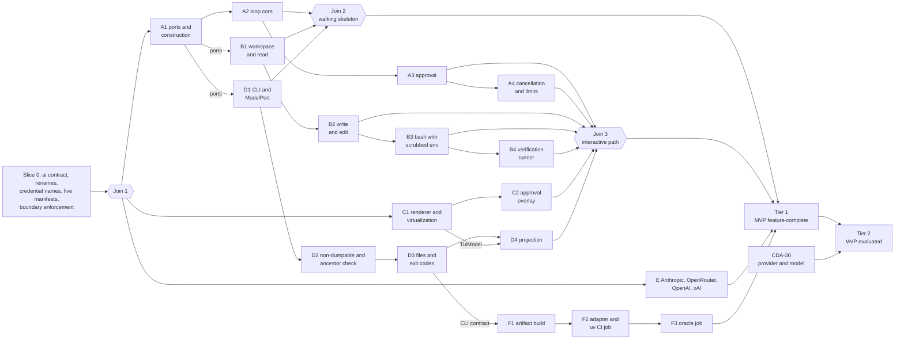

# Implementation Order and MVP Completion Checklist

Status: accepted

Date: 2026-09-13

## Context

[Decide implementation order and the MVP completion checklist](https://datn-fit-hcmus.atlassian.net/browse/CDA-22)
asks which vertical implementation order minimizes integration risk once the package, provider,
runtime, tool, TUI, context, verification, and TerminalBench decisions are resolved, and which
observable checklist proves the MVP destination has been reached.

Every architectural decision this order depends on is recorded:

- [Tool contracts and safety policy](./0001-tool-contracts-and-safety-policy.md) fixes the four tool
  contracts, the path jail, the Approval Policy, the 40 KiB output budget, and, in §8, credential
  isolation for tool and Verification processes.
- [Agent Session state machine and event protocol](./0002-agent-session-state-machine-and-event-protocol.md)
  fixes nine states, nineteen Session Event types, and the Agent Session interface.
- [MVP context, planning, verification, and session memory](./0003-mvp-context-planning-verification-and-session-memory.md)
  fixes Project Instructions discovery, planning as a prompt requirement, the Verification outcomes,
  and the session limits.
- [Package APIs and dependency direction](./0004-package-apis-and-dependency-direction.md) fixes five
  packages, an allowlisted type-only graph with one composition root, and the boundary enforcement.
- [TerminalBench evaluation protocol](./0005-terminalbench-evaluation-protocol.md) fixes the pins, the
  headless command line, the files written, the adapter, the procedure, and five completion criteria
  of its own.

The repository does not match those decisions yet. `packages/ai` holds six provider adapters whose
exports predate the provider contract in ADR 0004 §2. `packages/agent-core`, `packages/tools`, and
`packages/coding-agent` hold only a `CONTEXT.md`. `packages/tui` holds the throwaway CDA-17 spike.
No package imports another, no package other than `ai` has a manifest, and nothing enforces the
boundary rules. The model catalogs carry `id`, `name`, and `provider` only, with no capability or
pricing metadata.

Two constraints shaped this order. Provider spend is a real limit on a university project, so the
provider that people run all day cannot be chosen for architectural tidiness alone. And
[Decide whether tool processes inherit provider credentials](https://datn-fit-hcmus.atlassian.net/browse/CDA-29)
resolved as ADR 0001 §8 while this decision was being written, which is why the credential rule is
placed in slices rather than deferred. That rule is not one line in the `bash` tool: it puts the
credential variable names in `ai`, the scrubbed child environment in `tools` for both `bash` and the
Verification Runner, and the non-dumpable hardening plus the `"auto-approve"` startup ancestor check
in the composition root, with the per-backend isolation test in the evaluation track. The order
carries it in four places.

## Decision

### 1. Shape of the order

The order is a dependency graph, not a linear sequence. One blocking slice comes first, then five
tracks run in parallel and meet at three named join points.

A package-by-package order was rejected: it concentrates every integration failure into the final
week, which is the risk this ticket exists to reduce. A pure walking skeleton with no preparation was
also rejected, because ADR 0004 §1 makes the package graph and its enforcement a precondition for
every later slice, and retrofitting boundaries after five packages exist is the expensive direction.

The graph is parallel because ADR 0004's consequences already make each leaf package testable in
isolation: Agent Core against a fake `ModelPort`, fake tools, a fake `WorkspaceResolver`, an injected
clock, and deterministic IDs; `tools` against a temporary repository; `tui` against hand-built
`TuiModel` values through `@xterm/headless`. A linear order would leave most of the team idle while
those suites are exactly what can be written concurrently.

Each slice below is sized to one ticket. This record carries no dates: scheduling belongs to the
tracker, and a sprint boundary moving is not a change to this decision.

Node prefixes name the track: A is Agent Core, B is Tools, C is Terminal UI, D is Coding Agent,
E is provider breadth, F is evaluation. An arrow into a join means the join needs that slice, not
that the join unlocks later work: the tracks keep running past a join they have already fed.

### 2. Slice 0: the contract pass

Slice 0 blocks every other slice and contains no agent behavior.

- Implement the provider-neutral contract of ADR 0004 §2 in `packages/ai`: tools on `Context`,
  `tool_call` and `tool_result` content, `ModelStream`, `FinishReason` with the raw provider value,
  `ToolDeclaration`, and `ModelCapabilities`.
- Apply the ADR 0004 §8 rename table. It is mechanical only while `packages/ai` is the sole consumer
  of those names.
- Pass the transport retry bound from the caller to both SDK clients, which today default to two
  retries (ADR 0004 §2 and its consequences).
- Declare `ModelCapabilities` as constants per provider and API variant, chosen by the variant
  selector, with per-model overrides only where a model genuinely differs. Capabilities follow the
  API a provider speaks, and the same wire format can still differ between providers (xAI's
  Chat-Completions-compatible endpoint delivers tool arguments whole while OpenAI streams them), so
  neither the provider nor the variant alone is enough. Adding five fields to 385 catalog entries
  would create rows that rot silently.
- Add the API-variant selector of ADR 0004 §2 and make Google conformant through its
  `generateContent` variant, replacing today's route through Gemini's OpenAI-compatible Chat
  Completions endpoint. The Interactions variant is not implemented in the MVP: it links turns
  through a server-side `previous_interaction_id`, and whether that fits Agent Core owning the
  transcript (ADR 0002) is unverified. The selector leaves room to add it later without a new
  provider.
- Export the provider credential variable names from `ai`. ADR 0001 §8 makes `ai` the single source
  of truth for that set. The composition root reads it and supplies it to `tools`, so it belongs
  in the slice that fixes `ai`'s public surface rather than in whichever slice needs it first.
- Give all five packages a manifest following `packages/ai` (`private: true`,
  `exports: { ".": "./src/index.ts" }`) with the §1 allowed edges as `workspace:*` dependencies.
- Add the ADR 0004 §9 enforcement: Biome `noRestrictedImports` overrides per package, `noEnum`, and
  the CI job that bundles each leaf entry point with `bun build --external '@coding-agent/*'` and
  fails on a remaining sibling import.

Exit criteria: `bun --filter '*' typecheck`, `bun test`, and `biome ci .` pass; `ai` streams a Tool
Call from Google through the `generateContent` variant, both against a recorded fixture and against
the live API; and a deliberately added
forbidden import fails CI. The last one matters because an enforcement rule that has never failed has
not been shown to work.

### 3. Tracks

**Track A, Agent Core.** The critical path.

| Slice | Contents | Exit criterion |
| --- | --- | --- |
| A1 | Construction and ports: `openAgentSession`, `ModelPort`, `Clock`, `IdSource`, `SessionLimits`, `WorkspaceResolver`, `RepoPath`, `ExecutableTool`, `ToolRegistry`, `VerificationPolicy`, and the full Agent State and Session Event type surface | Invalid construction returns `INVALID_CONFIGURATION` and creates no session, event, or transition |
| A2 | Loop core: `ready`, `streaming_model`, `executing_tool`, `verifying`, `succeeded`, `failed`; transcript commitment; Candidate Completion; sequential dispatch; preflight in ADR 0002 §4 order; the auto-approved path | A fake `ModelPort` and fake tool drive a task to `succeeded` with the event sequence asserted |
| A3 | Approval: `awaiting_approval`, `approval_requested`, `approval_resolved`, deny paths, and the self-transitions of ADR 0002 §2 | Allow, deny with a queued call remaining, and deny with none remaining each reach the right state |
| A4 | Cancellation and limits: `cancelling`, the grace period, `runtime_limit_reached`, `LIMIT_EXCEEDED`, `partialChangesPossible` | Cancellation from every nonterminal state settles as `cancelled`, or as `failed` with `CANCELLATION_TIMEOUT` |

**Track B, Tools.** Starts once A1 has published the ports.

| Slice | Contents | Exit criterion |
| --- | --- | --- |
| B1 | `createWorkspaceResolver` and `read` | Symbolic links and paths outside `repoRoot` are rejected as `PATH_OUTSIDE_REPO` against a temporary repository |
| B2 | `write` and `edit` | Temporary-file write with atomic rename, and the 40 KiB head-and-tail budget, both asserted byte-exactly |
| B3 | `bash`, built on the scrubbed child environment of ADR 0001 §8 rule 1 | A `bash` Tool Call cannot read a provider credential from its inherited environment, and the stripped set is exactly the names `ai` declares, leaving variables the task or user set untouched |
| B4 | The Verification Runner behind `VerificationPolicy`, outside Agent Core per ADR 0004 §7, on the same scrubbed environment that ADR 0001 §8's Verification parity requires | `completed` with exit 0, `completed` with a non-zero exit, `timed_out`, and `launch_failed` each map to the ADR 0003 §3 outcome, and a Verification command cannot read a provider credential either |

**Track C, Terminal UI.** Starts at Join 1 and depends on no sibling.

| Slice | Contents | Exit criterion |
| --- | --- | --- |
| C1 | Renderer shell, inline transcript, and viewport windowing over hand-built `TuiModel` values | A transcript longer than the viewport scrolls correctly under `@xterm/headless` assertions |
| C2 | Approval overlay composited over the transcript, input policy, and the cancel key | An overlay renders and returns `onApproval` decisions without disturbing transcript state |

The split rail stays out of the MVP. ADR 0004 §5 already makes it opt-in, which makes it the one
piece of the interaction model that can slip without weakening anything the destination names.

**Track D, Coding Agent.** Starts once A1 has published the ports, because D1's `ModelPort` adapter
and `coding-agent run` both need `ModelPort` and `openAgentSession`, which Agent Core defines. D4
also needs `TuiModel` from C1, because `tui` owns that type. Owns the two later joins.

| Slice | Contents | Exit criterion |
| --- | --- | --- |
| D1 | Configuration, CLI parsing, the `ModelPort` adapter over `ai`, the system prompt assembly of ADR 0003 §1 and §2, and `coding-agent run` | Usage and configuration errors exit 2 before any Agent Session opens |
| D2 | The composition root's two ADR 0001 §8 duties: marking the process non-dumpable through `prctl` before the first tool or Verification child, and, under `"auto-approve"` only, walking the ancestor chain at startup and refusing to open a session when an ancestor still holds a credential | A launcher that does not `exec`-replace itself is rejected with exit 2, and a same-uid child cannot read the Coding Agent process's `/proc/<pid>/environ` or `/proc/<pid>/mem` |
| D3 | The full ADR 0005 §3 and §4 contract: exit codes 0, 1, 130, 2, 70; `run.json`, `events.jsonl`, `result.json` at `schemaVersion` 1; the `default` and `terminalbench` profiles | A smoke test per exit code asserts the files each run writes |
| D4 | `projectSessionEvent` and the interactive path | The projection has unit tests and performs no I/O |

**Track E, provider breadth.** Runs from Join 1, parallel to everything else: Anthropic, then
OpenRouter, OpenAI, xAI, and OpenCode, each against one shared conformance suite of recorded
fixtures. Exit
criterion: every provider passes the same suite, and each declared deviation is a typed capability
rather than a branch inside Agent Core.

On 2026-11-12, [CDA-30](https://datn-fit-hcmus.atlassian.net/browse/CDA-30) amended this record:
[ADR 0007](./0007-evaluation-provider-and-model.md) makes `opencode` a sixth `--provider` value for
the recorded evaluation job. It joins track E, so the checklist below grows to six providers and
tier 1 completes only when the Go adapter's conformance (CDA-112) passes the shared suite. It was
not among the values ADR 0005 §3 accepted before this; its adapter stayed
in `packages/ai` and kept working, but it was excluded from the conformance suite, from the
completion checklist and from that command line. The promotion is a scope change to
[the map](https://datn-fit-hcmus.atlassian.net/browse/CDA-13) rather than an ordering choice, and
the map still lists five providers until its owners update it.

**Track F, evaluation.** Starts after D3, because the adapter depends on the command line and the
files.

| Slice | Contents | Exit criterion |
| --- | --- | --- |
| F1 | The artifact build of ADR 0005 §2: both targets, `artifact-manifest.json`, and `--version` | `--version` output matches the manifest for both executables |
| F2 | The Python adapter at `evaluation/terminalbench/`, plus a CI job that runs its tests with `uv --frozen`. Its command satisfies ADR 0001 §8's launch contract: it `exec`s the agent so Harbor's credential-bearing shell is replaced, and pipes its output nowhere (ADR 0005 §6) | Command construction, exit-code mapping, single-key forwarding, and ATIF conversion of a complete and a truncated event log all pass, each validated against Harbor's `Trajectory` model, and a test asserts the command `exec`s with no pipeline |
| F3 | The oracle job of ADR 0005 §7 step 2 | The job completes on Modal and its harness-flaky tasks are listed |

The oracle job is in the MVP because it receives no credential and no model spend, though it does
cost Modal compute, so it is the one Harbor job that can prove the dataset pin, the Harbor pin, `uv --frozen`, and Modal access before the
recorded job depends on all four.

### 4. Join points

- **Join 1, after Slice 0.** The contract and the boundary graph exist. Tracks A, C, and E start;
  tracks B and D start once A1 lands, because both implement or consume ports that A1 defines.
- **Join 2, the walking skeleton.** A2, B1, and D1 meet: headless `coding-agent run` completes the
  named fixture task using Google, `read` only, the auto-approved path, and no configured
  verification command, exiting 0. This is the first moment a real model response drives a real tool
  through a real session, and it is deliberately reached through the headless entry point: it needs
  no Ink, no projection, and it is the contract the evaluation adapter consumes. The TUI is not
  deferred by this, because track C has been running since Join 1.

  ADR 0001 §8 does not gate this join, even though ADR 0005 §3 makes `--approval-policy auto-approve`
  mandatory on the headless path. The skeleton registers `read` only, so it starts no child process
  and §8 has nothing to guard yet. §8 becomes mandatory the moment B3 or B4 lands a tool that spawns
  one, and D2 must precede D3, because D3 is where the headless contract is declared complete.
- **Join 3, the interactive path.** A3, A4, B2, B3, B4, C2, and D4 meet: the same named task runs
  through the full-screen TUI with one approval and one cancellation. D2's ancestor check does not
  gate this join: ADR 0001 §8 scopes that check to `"auto-approve"` and accepts the `"ask"` residual,
  so the interactive path is unaffected by it.

### 5. Provider for first light and for daily use

Google is the first conformant provider and the daily driver, on a `flash-lite` or `flash` model.

The reason is cost, and it is not a compromise. The deterministic end-to-end test runs against
recorded fixtures (§6 item 5), so live provider spend touches only manual development loops and the
demo, and a free tier covers both. Google also carries a design payoff: it is the provider furthest
from the Anthropic-shaped normalization of ADR 0004 §2, so the first slice exercises the API-variant
selector rather than discovering it last. The cost accepted is that the first provider is also the
hardest, which lengthens Slice 0.

Anthropic is second, on `claude-haiku-4-5`, precisely because it is the cheap check on whether the
normalization leaked Google's shape.

### 6. Tier 1: MVP feature-complete

Tier 1 is reached when all of the following are observable. No item is satisfied by a claim that
something works.

1. Agent Core implements all nine states and all nineteen Session Event types. Every event has an
   emitter except `tool_execution_progress` and `verification_progress`, which are declared without
   one: ADR 0004 §3 shapes `ToolProgress` with the first tool that reports progress, and ADR 0005 §4
   already omits both from the on-disk log.
2. The four tools satisfy ADR 0001, including schemas, the path jail, the 40 KiB budget, and the bash
   timeout bound. Credential isolation per ADR 0001 §8 is shown by test: neither a `bash` Tool Call
   nor a Verification command inherits a provider credential; a same-uid child cannot read the
   Coding Agent process's `/proc/<pid>/environ` or `/proc/<pid>/mem`; and under `"auto-approve"` a
   launcher that leaves a credential-bearing ancestor alive is rejected with exit 2. The
   cross-process guarantee is Linux-only and scoped to `"auto-approve"`, and the `"ask"` residual is
   accepted by ADR 0001 §8 rather than closed here.
3. Verification exercises all three configured-command outcomes (`succeeded`, `continue` with the
   injected feedback message, `failed` with `VERIFICATION_FAILED`) and the non-gating fallback with
   `no_command_configured` evidence.
4. `coding-agent run` implements ADR 0005 §3 and §4, with a smoke test for exit codes 0, 1, and 2 and
   the files each writes. This is ADR 0005 §9 criterion 1.
5. An automated end-to-end test in `packages/coding-agent/tests` runs the named fixture task, "add a
   failing test, then make it pass", against recorded provider fixtures, deterministically, in CI.
   The fixture repository is a directory of files the test copies into a temporary directory. The
   composition root is the only place that legitimately touches all five packages, which is why the
   test lives there rather than in a sixth location outside the enforcement model.
6. The same named task runs through the full-screen TUI against a live provider, exercising one
   approval and one cancellation, with a committed demo script and a recorded terminal capture. A
   checklist item that reads "the demo works" is not checkable, and the recording is what survives
   into the thesis and to a reviewer who was not present.
7. All six providers pass the shared conformance suite: Google, Anthropic, OpenRouter, OpenAI, xAI,
   and `opencode`, the sixth provider, per [ADR 0007](./0007-evaluation-provider-and-model.md).
8. Boundary enforcement is in place and has been shown to fail: per-package manifests, the Biome
   overrides, and the CI bundle check, with `bun --filter '*' typecheck`, `bun test`, and
   `biome ci .` green.
9. The artifact build produces both executables and `artifact-manifest.json`, and `--version` matches
   the manifest. This is ADR 0005 §9 criterion 2.
10. The adapter's tests pass in CI under `uv`. This is ADR 0005 §9 criterion 3.
11. The oracle job has run on Modal and its harness-flaky tasks are recorded. This is the one tier-1
    item that is not free: it needs a Modal account and pays compute for all 66 task environments,
    three of them with an H100, though it uses no model and no credential.
12. ADR 0004 and ADR 0005 are marked `accepted`. This record marks them so; implementing against a
    proposed record invites re-litigating a five-package boundary decision mid-build.

### 7. Tier 2: MVP evaluated

Tier 2 is the recorded benchmark result. The line between the tiers is not whether Modal is
involved, since tier 1's oracle job runs there too. It is drawn where a job carries a provider
credential and spends on a model. Every tier-2 job does both, so tier 2 is gated on the isolation
test passing in a container on each backend a job will use, it spends model money on top of
compute, it depends on provider rate limits the team does not control, and the provider and model
it runs on was an open decision until [ADR 0007](./0007-evaluation-provider-and-model.md) (item 3).
Tier 1 has no credential, no model spend, and no open
decision: it is code and tests on a developer machine, plus one oracle job that needs a Modal account
and compute (§6 item 11). A checklist whose final item cannot be scheduled cannot tell the team when
to stop building, which is why the line is drawn here.

The split is not a licence to treat tier 2 as optional. The map's destination names reproducible
TerminalBench evaluation, so the MVP reaches it only when both tiers are complete.

1. ADR 0005 §9 criterion 4. Its first clause is already satisfied: CDA-29 is resolved by ADR 0001 §8,
   an accepted amendment. What remains is that the evaluated artifact implements §8 and that the
   automated isolation test has passed on each backend used, inside containers built from
   Terminal-Bench task images, as both a root and a non-root agent user, recorded in the artifact
   manifest for that commit.
2. ADR 0005 §9 criterion 5: the smoke, recorded, and any rerun jobs have run after criterion 4 held;
   the recorded job is valid under ADR 0005 §7; its manifest and report are committed; and its
   archive passed the secret scan and is published.
3. The evaluation provider and model are chosen. ADR 0005 §7 states that it does not choose the
   model, and this record did not either: a cheap weak model produces a valid job that says nothing,
   so the choice needed its own thinking and became its own decision ticket on the map.
   [ADR 0007](./0007-evaluation-provider-and-model.md) resolves it: `opencode` with
   `deepseek-v4.1-flash`, recorded as a configuration result rather than a capability ceiling. Its
   implementation (CDA-112) and that provider's HTTP status (CDA-83) are tier-1 work, because the
   provider joins track E.

Item 3 blocked nothing in tier 1 when this record was written, but its resolution does: ADR 0007
promotes `opencode`, which puts the Go adapter's conformance (CDA-112) inside track E and therefore
inside tier 1 item 7, so tier 1 completes only when that adapter passes the suite. It also carried
lead time that is not decision time — a paid key, a rate limit checked at the concurrency the job
will use — and it reached back into tier 1, because ADR 0005 §7's rerun condition needs that
provider's HTTP status from CDA-83. Deciding late risked reopening a tier-1 item that was already
called complete, which is why it was asked for while tier 1 was still running.

No reward value is a criterion, in either tier.

### 8. Pi attribution is deferred past the MVP

ADR 0004 §8 requires `packages/ai/src/utils/event-stream.ts` to carry Pi's MIT copyright and
permission notice or be rewritten. That requirement stands; this record sets only its timing, and
it is not a completion criterion in either tier.

More code is likely to be adapted from Pi while the tracks run, and the repository stays private
until the MVP is complete, including the choice of this project's own license. ADR 0005 §7 attaches
evaluation assets to a Release of this same private repository, so no Pi-derived code reaches anyone
outside it during either tier. Attribution is therefore one pass over every Pi-derived file after the
MVP, done before the repository, an executable, or any release is made public. So that the pass is a
lookup rather than a search, each pull request that adapts code from Pi names the files it adapted.

## Consequences

- Slice 0 is a wide change to `packages/ai` with no user-visible behavior, and nothing else can start
  until it merges. That is the cost of putting the boundary graph and the provider contract before
  any agent behavior.
- Credential isolation is no longer a dependency on an open decision: ADR 0001 §8 fixes it, and this
  order places it in Slice 0 (`ai` exports the names), B3 and B4 (the scrubbed child environment),
  D2 (non-dumpable hardening and the `"auto-approve"` ancestor check), F2 (the adapter's `exec` launch
  contract), and tier 2 (the per-backend isolation test). The cost is that a security rule is spread
  across four packages, so no single slice can be reviewed as "the credential slice".
- D2 introduces `bun:ffi` to reach `prctl`, which is the first non-portable call in the codebase. The
  cross-process guarantee it buys exists only on Linux under `"auto-approve"`, so day-to-day
  development on macOS runs with the `"ask"` residual that ADR 0001 §8 accepts.
- Tier 1 can be reached, demonstrated, and written up without model spend or a credential-carrying
  job; its only paid step is one oracle job on Modal. Tier 2 cannot start until the credential rule is implemented and tested per
  backend.
- The MVP ships without the split rail and without progress events for tools or Verification. Both
  are declared deferrals, not omissions.
- Reaching Join 2 through the headless entry point means the first end-to-end proof is not the
  full-screen TUI the destination names. Track C running from Join 1 is what keeps that from becoming
  a late surprise; if track C stalls, Join 3 becomes the schedule risk of the whole plan.
- The named fixture task becomes a fixed artifact. Changing it changes what items 5 and 6 assert, so
  it is edited deliberately rather than adjusted to whatever currently passes.
